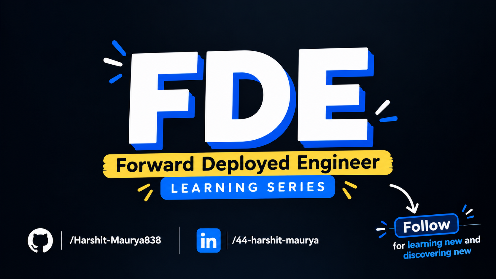
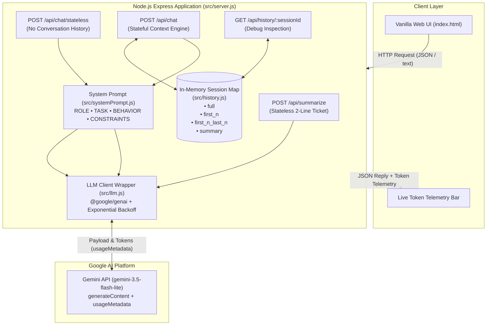

<p align="center"></p>

# Part 2: Building Your First GenAI App — Architecture, Memory & Token Economics

> Hands-on implementation of a production-grade Generative AI backend service: wrapping foundation models, engineering conversational state, profiling context window cost curves, enforcing strict persona guardrails, and calibrating hallucination defenses.

[](https://nodejs.org/)
[](https://expressjs.com/)
[](https://ai.google.dev/)
[](../README.md)
[](../LICENSE)

---

## 🧭 What This Project Demonstrates

Foundation models (such as Google Gemini) are inherently **stateless next-token predictors**. They do not maintain a session, remember previous questions, or inherently respect enterprise domain boundaries.

This module builds a complete customer support backend for a food delivery service (**"QuickBite"**), demonstrating five core architectural principles required of every Forward Deployed Engineer:

1. **App Wrapped Around a Raw LLM**: Integrating the official Google Gen AI SDK (`@google/genai`) into a standard REST API backend (Express) with automatic rate-limit backoff (`429`) and high-load retries (`503`).
2. **Stateless LLM Calls**: Demonstrating why a raw LLM call forgets everything across HTTP requests unless state is explicitly re-transmitted.
3. **Chat History & Token Economics**: Benchmarking four distinct context-management strategies (`full`, `first_n`, `first_n_last_n`, and `summary`) across a 20-message conversation to measure memory retention vs. token cost.
4. **4-Part System Prompting**: Constructing structured prompts with labeled parts (`ROLE`, `TASK`, `BEHAVIOR`, `CONSTRAINTS`) to enforce polite 2-sentence support responses and strictly reject out-of-scope requests (e.g. programming or DevOps queries).
5. **Hallucination Calibration**: Stress-testing the model with fictitious entities (a non-existent international treaty, an invented Stanford curriculum, and a satirical Apple hamburger) to demonstrate how epistemic grounding prevents confabulation.

---

## 🏗️ Architecture



---

## ⚡ Quick Start & Run Steps

### Prerequisites
- Node.js 18.0.0 or higher (`node -v`)
- npm 9.0.0 or higher
- A Google Gemini API key from [Google AI Studio](https://aistudio.google.com/)

---

### 1. Installation

#### Linux / macOS:
```bash
# Navigate to the project directory
cd 02-first-genai-app

# Install dependencies
npm install

# Create environment configuration
cp .env.example .env
```

#### Windows (PowerShell):
```powershell
# Navigate to the project directory
cd 02-first-genai-app

# Install dependencies
npm install

# Create environment configuration
Copy-Item .env.example .env
```

#### Windows (Command Prompt):
```cmd
cd 02-first-genai-app
npm install
copy .env.example .env
```

---

### 2. Configure Environment Variables

Edit the `.env` file to add your API key:
```ini
# Google Gemini API Key from Google AI Studio
GEMINI_API_KEY=your_actual_gemini_api_key_here

# Model identifier (defaults to gemini-3.5-flash-lite)
GEMINI_MODEL=gemini-3.5-flash-lite

# Express server port
PORT=3000

# Default N parameter for history strategies
DEFAULT_HISTORY_N=2

# Food delivery brand name for system prompt
COMPANY_NAME=QuickBite
```

---

### 3. Start the Application

```bash
# Start server in production mode
npm start

# Or start in watch/development mode
npm run dev
```

Open your browser and navigate to:
👉 **[http://localhost:3000](http://localhost:3000)**

You will see:
- The QuickBite interactive chat interface
- The Strategy dropdown (`full`, `first_n`, `first_n_last_n`, `summary`)
- Live Token Counter updating input, output, and cumulative tokens after every message
- The **"Ticket Summarizer"** modal for testing `POST /api/summarize`

---

### 4. Run the Experiments

Each experiment runs automated benchmarks against the Gemini API and generates clean markdown logs inside the [`./results`](./results) directory.

```bash
# Run all 4 experiments sequentially
npm run experiments

# Or run individual experiments:
npm run experiment:1    # Memory (Stateless vs Stateful)
npm run experiment:2    # Token Growth across 4 History Strategies
npm run experiment:3    # System Prompt Guardrails & Behavioral Shaping
npm run experiment:4    # Hallucination & Factuality Calibration
```

---

## 📡 API Endpoints Reference

| Method | Endpoint | Headers / Content-Type | Body Payload | Description |
| :--- | :--- | :--- | :--- | :--- |
| `POST` | `/api/summarize` | `text/plain` | Raw customer complaint ticket | Summarizes an incoming support ticket in exactly 2 lines via a single stateless call. Returns `{ summary, usage }`. |
| `POST` | `/api/chat/stateless` | `application/json` | `{"message": "..."}` | Sends only the immediate prompt with the system prompt, retaining no conversational history. Returns `{ reply, usage }`. |
| `POST` | `/api/chat` | `application/json` | `{"sessionId": "...", "message": "...", "strategy": "...", "n": 2}` | Stateful multi-turn chat endpoint. Applies the requested history strategy (`full`, `first_n`, `first_n_last_n`, `summary`), calls Gemini, and records the turn in memory. |
| `GET` | `/api/history/:sessionId` | `application/json` | None | Returns stored turn array and running summary for debugging. |
| `DELETE` | `/api/history/:sessionId` | `application/json` | None | Flushes and resets memory for the designated session. |

---

## 📊 Empirical Findings & Results

All data in this section reflects **actual recorded runs** stored in [`./results/`](./results/).

### 1. Memory: Stateless vs. Stateful ([`results/01_memory.md`](./results/01_memory.md))

| Condition | Turn 1 Prompt & Reply | Turn 2 Prompt & Reply | Remembers Name? | Turn 2 Input Tokens |
| :--- | :--- | :--- | :---: | :---: |
| **Stateless Call** (`/api/chat/stateless`) | **U:** `"Hi, my name is Harshit"`<br/>**A:** `"Hello Harshit! How can I help you..."` | **U:** `"What is my name?"`<br/>**A:** `"I'm sorry, but I can only assist with food delivery support... Could you please share your order ID?"` | ❌ **No** | **108 tokens** |
| **Stateful Call** (`/api/chat`) | **U:** `"Hi, my name is Harshit"`<br/>**A:** `"Hello Harshit! Welcome to QuickBite support..."` | **U:** `"What is my name?"`<br/>**A:** `"You told me your name is Harshit! How can I assist you with your QuickBite order today?"` | ✅ **Yes** | **152 tokens** |

> **Takeaway:** Raw LLMs retain zero state between API calls. Conversational memory is strictly an application-tier illusion achieved by feeding past turns back into subsequent prompt payloads.

---

### 2. Context History Strategies & Token Growth ([`results/02_token_growth.md`](./results/02_token_growth.md))

In this benchmark, 20 consecutive customer turns were executed through each strategy. In Turn 2, the user stated: *"My order ID is #48291 and my name is Harshit."* At Turn 20, the model was asked: *"What was the order ID and customer name I gave you earlier?"*

| Strategy | Token Growth Pattern | Turn 1 Input | Turn 10 Input | Turn 20 Input | Recalled Order ID? | Recalled Name? |
| :--- | :--- | :---: | :---: | :---: | :---: | :---: |
| **Full History (`full`)** | Linear $O(N)$ growth | 112 tok | 543 tok | **1,001 tok** | ✅ Yes | ✅ Yes |
| **First N (`first_n`, N=2)** | Completely flat $O(1)$ | 112 tok | 170 tok | **172 tok** | ❌ No | ❌ No |
| **First N + Last N (`first_n_last_n`, N=2)** | Bounded $O(1)$ | 112 tok | 199 tok | **208 tok** | ❌ No | ❌ No |
| **Running Summary (`summary`)** | Sublinear / compressed | 112 tok | 312 tok | **316 tok** | ✅ **Yes (#48291)** | ❌ No |

```text
Turn 20 Input Tokens Comparison:
------------------------------------------------------------
full             ██████████████████████████████ 1,001 tokens (100%)
summary          █████████ 316 tokens (68.4% cost reduction!)
first_n_last_n   ██████ 208 tokens (79.2% reduction, but dropped Turn 2)
first_n          █████ 172 tokens (82.8% reduction, but dropped Turn 2)
```

> **Takeaway:** While `full` retains all facts, its token cost explodes linearly. Blind slicing (`first_n`) drops critical middle facts. Running summaries compress older history by **68.4%** while preserving crucial business entities (like Order `#48291`).

---

### 3. System Prompt Guardrails & Cost Impact ([`results/03_system_prompt.md`](./results/03_system_prompt.md))

Evaluating raw foundation model output vs. our 4-part system prompt (`ROLE`, `TASK`, `BEHAVIOR`, `CONSTRAINTS`):

| Test Query | Raw Model (Without System Prompt) | Guarded Agent (With QuickBite Prompt) | Cost / Token Difference |
| :--- | :--- | :--- | :--- |
| **[In-Scope] Pizza arrived 45m late & cold** | Generates 715 output tokens with generic advice on chargebacks and credit cards. | Polite 2-sentence empathy, immediately requests Order ID (31 output tokens). | **95.6% reduction in generated tokens** |
| **[In-Scope] Wrong address for order #55123** | 98 output tokens asking for customer's full name. | Concise 2-sentence policy explanation: cannot modify address post-order, contact driver directly (53 output tokens). | Clear domain policy applied |
| **[Out-of-Scope] "What is Docker?"** | Writes an 809-token essay explaining namespaces, cgroups, images, and containers. | Polite 2-sentence refusal: *"I'm sorry, but I can only assist with food delivery support related to QuickBite."* (39 tokens) | **95.1% reduction** in token waste |
| **[Out-of-Scope] Python Merge Sort script** | Generates 638 tokens of Python code and execution explanations. | Strictly refuses: *"I apologize, but I can only assist with QuickBite food delivery inquiries."* (46 tokens) | **92.8% reduction** in token waste |

---

### 4. Hallucination & Factuality Grounding ([`results/04_hallucination.md`](./results/04_hallucination.md))

Testing how the model responds to nonexistent entities with and without explicit epistemic instructions:

| Fictitious Query | Without Grounding Instruction | With Grounding Instruction |
| :--- | :--- | :--- |
| **2024 International Food Drone Transport Treaty** (Nonexistent law) | Correctly identified that no such treaty exists, but generated 136 tokens of hypothetical aviation commentary. | Compact 70-token factual refusal stating the treaty does not exist in reality. |
| **Stanford CS992: Quantum Prompt Metallurgy** (Fictitious course) | Notes that the course combines buzzwords from multiple fields in a fictional manner (98 tokens). | Directly states there is no record of CS992 in verified Stanford curricula (53 tokens). |
| **Apple iBurger Pro 2025 with Neural Bun** (Satirical product) | **Playfully hallucinated specifications:** M4 Patty Chip, 512GB internal sodium, spatial audio lettuce leaf (148 tokens). | **Strictly factual refusal:** *"The Apple iBurger Pro 2025 and its 'Neural Bun sensor' do not exist. Apple has never announced or released such a product."* (44 tokens) |

---

## 🎯 Key Takeaways for Forward Deployed Engineers

1. **Tokens Are Currency**:
   Every token passed into an LLM costs money and latency. Chat memory is not free—re-sending 1,000 tokens on every turn across millions of active customer chats creates exponential cost curves.
2. **Memory is an Application Architecture Problem**:
   Do not rely on the LLM to manage its own memory. As an FDE, you must architect hybrid context strategies: cache persistent system prompts, preserve initial session metadata (user name, customer ID), compress middle conversations with running summaries, and retain only recent active turns.
3. **Structured System Prompts Eliminate Ambiguity**:
   A prompt structured with explicit labeled sections (`ROLE`, `TASK`, `BEHAVIOR`, `CONSTRAINTS`) provides strict behavioral boundaries. Restricting output length to *"at most 2 sentences"* dramatically cuts LLM generation time and customer support latency.
4. **Resilience Against API Realities**:
   Enterprise APIs face rate limits (`429`) and infrastructure spikes (`503`). Implementing exponential backoff and respecting Google's `retryDelay` headers at the SDK wrapper level makes applications resilient under production load.
5. **Calibrate Against Hallucinations**:
   Never trust zero-shot prompt honesty when handling enterprise domain data. Explicit negative constraints (*"If you do not know or if the topic does not exist, explicitly state that you do not know"*) paired with low temperatures ($T \le 0.2$) are necessary to prevent confabulation.

---

## 🗺️ 7-Part Series Roadmap


| Part | Module | Status | Directory | Primary Focus Areas |
| :---: | :--- | :---: | :--- | :--- |
| **01** | **[LLM Basics](../LLM_Basics)** | ✅ Completed | [`../LLM_Basics`](../LLM_Basics) | Tokenization mechanics (`tiktoken`), temperature sampling, bigram context failure, and logits $\to$ softmax dynamics. |
| **02** | **First GenAI App** | ✅ Completed | [`./`](./) | Express app, `@google/genai` SDK, stateless vs stateful memory, 4 history strategies & token cost, system prompt guardrails, and hallucination calibration. |
| **03** | **Embeddings & Vector DBs** | ⏳ Planned | `../03-embeddings-vector-dbs` | High-dimensional representations, cosine distance vs. dot product, vector indexing (HNSW), and embedding retrieval. |
| **04** | **RAG Systems** | ⏳ Planned | `../04-rag` | Retrieval-Augmented Generation: document ingestion, intelligent chunking, hybrid keyword/dense search, and reranking. |
| **05** | **Structured Outputs & MCP** | ⏳ Planned | `../05-structured-outputs-mcp` | Deterministic JSON schemas, Pydantic/Zod validation, tool calling, and Model Context Protocol (MCP). |
| **06** | **Multimodal & Evals** | ⏳ Planned | `../06-multimodal-evals` | Vision/audio inputs, synthetic dataset creation, automated evaluations, and LLM-as-a-judge benchmarking. |
| **07** | **Security & Agents** | ⏳ Planned | `../07-security-agents` | Prompt injection defenses, system guardrails, agentic loops, tool orchestration, and stateful memory. |

---

## 🎖️ Credits & Acknowledgments

This project is built as Part 2 of the **Forward Deployed Engineer Learning Series**, directly inspired by and expanding upon **Coder Army's FDE Course (Episodes 3 & 4)** by Love Babbar and Lakshay Kumar.

---

### License
This project is open-source under the [MIT License](../LICENSE).

