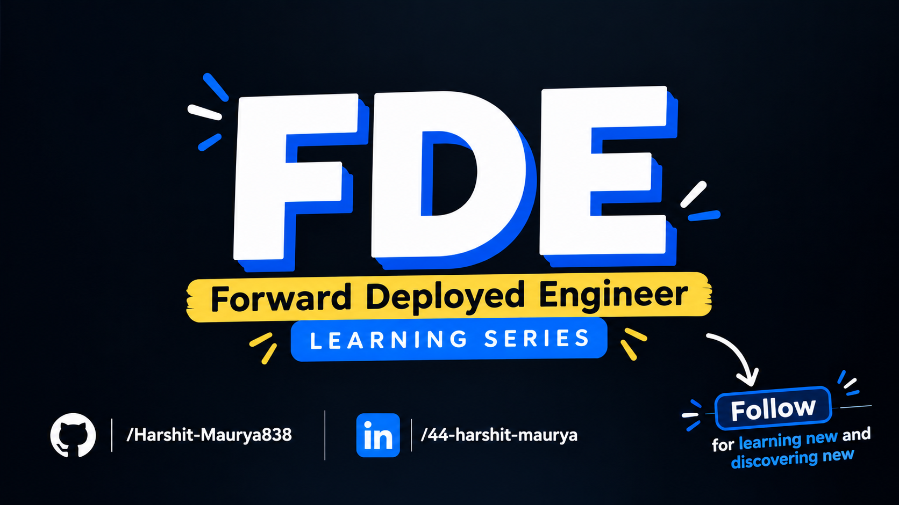
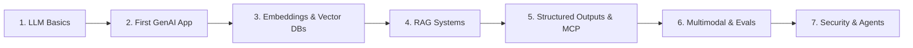

<p align="center"></p>

# Forward Deployed Engineer (FDE) Series

> A hands-on, code-first journey through building production-grade Generative AI systems—from first principles to enterprise deployment.

[](https://www.python.org/)
[](https://ai.google.dev/)
[](https://github.com/)
[](LICENSE)

---

## 🧭 About This Series

A **Forward Deployed Engineer (FDE)** in AI sits at the intersection of foundation models and real-world enterprise software. Raw LLMs are next-token predictors with probabilistic behavior—putting them into production requires robust engineering: retrieval systems, structured schemas, guardrails, performance profiling, and continuous evaluations.

This repository documents my **Learning in Public** journey through the comprehensive FDE curriculum, containing minimal, reproducible code, empirical experiments, and architectural takeaways for each stage of modern GenAI development.

---

## 🗺️ 7-Part Series Roadmap



| Part | Module | Status | Directory | Focus Areas |
| :---: | :--- | :---: | :--- | :--- |
| **01** | **[LLM Basics](./LLM_Basics)** | ✅ Completed | [`./LLM_Basics`](./LLM_Basics) | Tokenization (`tiktoken`), temperature sampling (Gemini API), bigram context failure, and logits $\to$ softmax mechanics. |
| **02** | **[First GenAI App](./02-first-genai-app)** | ✅ Completed | [`./02-first-genai-app`](./02-first-genai-app) | Express app, `@google/genai` SDK, stateless vs stateful memory, 4 history strategies & token economics, system prompt guardrails, and hallucination calibration. |
| **03** | **Embeddings & Vector DBs** | ⏳ Planned | `./03-embeddings-vector-dbs` | High-dimensional representations, cosine distance vs. dot product, vector indexing (HNSW), and embedding retrieval. |
| **04** | **RAG Systems** | ⏳ Planned | `./04-rag` | Retrieval-Augmented Generation: document ingestion, intelligent chunking, hybrid keyword/dense search, and reranking. |
| **05** | **Structured Outputs & MCP** | ⏳ Planned | `./05-structured-outputs-mcp` | Deterministic JSON generation, Pydantic schemas, function calling, and the Model Context Protocol (MCP). |
| **06** | **Multimodal & Evals** | ⏳ Planned | `./06-multimodal-evals` | Vision/audio inputs, synthetic dataset creation, automated evaluations, and LLM-as-a-judge benchmarking. |
| **07** | **Security & Agents** | ⏳ Planned | `./07-security-agents` | Prompt injection defenses, system guardrails, agentic loops, tool orchestration, and stateful memory. |

---

## 📂 Repository Structure

```text
.
├── thumbnail.png                 # Series cover banner
├── README.md                     # Root series overview (this file)
│
├── LLM_Basics/                   # Part 1: LLM Foundations
├── 02-first-genai-app/           # Part 2 (Coming soon)
├── 03-embeddings-vector-dbs/     # Part 3 (Coming soon)
├── 04-rag/                       # Part 4 (Coming soon)
├── 05-structured-outputs-mcp/    # Part 5 (Coming soon)
├── 06-multimodal-evals/          # Part 6 (Coming soon)
└── 07-security-agents/           # Part 7 (Coming soon)
```

---

## ⚡ Quick Start

### 1. Clone this repository
```bash
git clone https://github.com/Harshit-Maurya838/fde-series.git
cd fde-series
```

### 2. Configure environment variables
Most modules use Google Gemini APIs. Create a `.env` file at the root or within specific module folders:
```bash
# Linux / macOS
export GEMINI_API_KEY="your-gemini-api-key"
echo "GEMINI_API_KEY=your-gemini-api-key" > .env

# Windows (PowerShell)
$env:GEMINI_API_KEY="your-gemini-api-key"
```

### 3. Explore a specific module
Navigate into any completed module folder and follow its localized `README.md`:
```bash
cd LLM_Basics
python3 -m venv .venv
source .venv/bin/activate    # On Windows: .venv\Scripts\activate
pip install -r requirements.txt
python 01_tokenizer.py
```

---

## 🎯 Highlights from Part 1: LLM Basics

Explore [`./LLM_Basics`](./LLM_Basics) for the complete breakdown. Key empirical takeaways:

1. **Tokens $\ne$ Words:** `"I love coding"` takes **3 tokens** in `cl100k_base` and **4 tokens** in Gemini, while the Hindi phrase `"मुझे कोडिंग पसंद है"` explodes to **21 tokens** for 19 characters due to non-Latin byte fragmentation.
2. **Deterministic vs. Creative:** Temperature `0.0` operates via argmax greedy decoding (100% deterministic), whereas temperature `1.0` flattens the softmax probability curve, allowing diverse word sampling.
3. **Context Blindness in N-grams:** A bigram predictor ($N=2$) only looks at $w_{t-1}$, causing it to loop infinitely or lose topical coherence—demonstrating why Transformer **self-attention** ($Q, K, V$) is necessary to resolve polysemy and long-range intent.

👉 **[Read the Full Part 1 Deep Dive →](./LLM_Basics/README.md)**

---

### License
This repository is licensed under the [MIT License](LICENSE).
